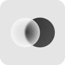
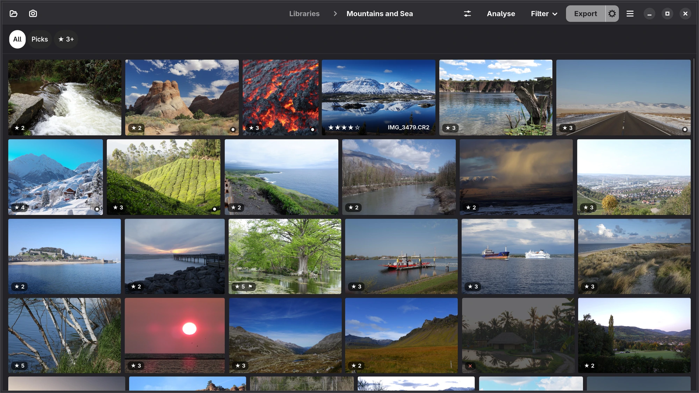
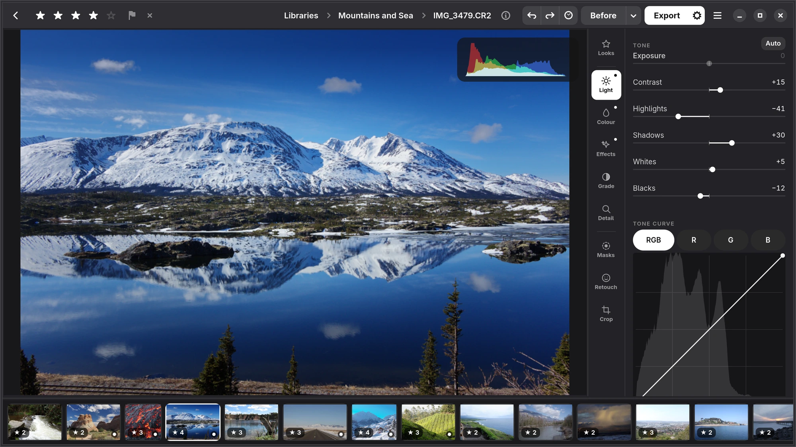

<p align="center">
  <picture>
    <source media="(prefers-color-scheme: dark)" srcset="data/branding/icon-dark.png">
    
  </picture>
</p>

<h1 align="center">Numa</h1>

<p align="center">
  <b>A RAW photo editor and library for Linux.</b><br>
  Add a folder, cull the shoot, develop the frames you keep, export them.<br>
  Your originals are never moved, copied or written to.
</p>

<p align="center">
  <a href="https://github.com/simmmmm/Numa/releases"><b>Download</b></a> ·
  <a href="https://guide.numa.photo">User guide</a> ·
  <a href="#installing">Installing</a> ·
  <a href="#building-from-source">Building</a> ·
  <a href="docs/ARCHITECTURE.md">Architecture</a> ·
  <a href="CONTRIBUTING.md">Contributing</a>
</p>



Numa is a GTK 4 and libadwaita application written in Rust. It reads every RAW
format [rawler](https://github.com/dnglab/dnglab) reads (29 formats from about
850 cameras) plus JPEG, PNG, HEIF, TIFF and WebP. Fujifilm files get extra
support: X-Trans demosaicking, the camera's film simulation and the lens
corrections stored in the RAF. Everything runs on your computer, including the
machine-learning models.

- **Library:** folders as libraries, ratings, flags, albums, people, search by
  words, and a catalog per library that moves with the folder.
- **Culling:** a loupe with burst comparison, sharpness, clipping and
  closed-eye checks.
- **Developing:** scene-referred editing, camera profiles, tone curves, colour
  mixer and grading, masks (subject, sky, click to select), retouching, AI
  denoise and lens corrections.
- **Export:** JPEG, PNG, TIFF, AVIF, JPEG XL and DNG.

The [user guide](https://guide.numa.photo) describes every feature. The code
was written with Claude (Anthropic).



## Installing

Packages for 64-bit Intel and AMD machines are built on the openSUSE Build
Service; a Flatpak and an AppImage are on the
[releases page](https://github.com/simmmmm/Numa/releases). All three use the
same folders, so you can switch between them.

**Fedora 44**

```sh
sudo dnf config-manager addrepo --from-repofile=https://download.opensuse.org/repositories/home:/Numa/Fedora_44/home:Numa.repo
sudo dnf install numa
```

**openSUSE Tumbleweed**

```sh
sudo zypper addrepo https://download.opensuse.org/repositories/home:/Numa/openSUSE_Tumbleweed/home:Numa.repo
sudo zypper refresh
sudo zypper install numa
```

**Ubuntu 26.04** (for Debian Testing, replace `xUbuntu_26.04` with `Debian_Testing`)

```sh
wget -qO- https://download.opensuse.org/repositories/home:/Numa/xUbuntu_26.04/Release.key | sudo gpg --dearmor -o /etc/apt/keyrings/numa.gpg
echo 'deb [signed-by=/etc/apt/keyrings/numa.gpg] https://download.opensuse.org/repositories/home:/Numa/xUbuntu_26.04/ /' | sudo tee /etc/apt/sources.list.d/numa.list
sudo apt update
sudo apt install numa
```

**Arch, CachyOS, EndeavourOS** (the package is `numa-photo`)

```sh
printf '\n[home_Numa_Arch]\nServer = https://download.opensuse.org/repositories/home:/Numa/Arch/$arch\n' | sudo tee -a /etc/pacman.conf
curl -fsSL https://download.opensuse.org/repositories/home:/Numa/Arch/x86_64/home_Numa_Arch.key | sudo pacman-key --add -
sudo pacman-key --lsign-key 5ADD29F2614AC31A0BD16A75AACA2C3967ED9794
sudo pacman -Syu numa-photo
```

Debian 13, Ubuntu 24.04 and older releases have no package; use the Flatpak or
the AppImage.

**Flatpak** (needs Flathub for the GNOME runtime)

```sh
flatpak install --user Numa-*-x86_64.flatpak
flatpak run com.tijmen.Numa
```

**AppImage** (glibc 2.39 or newer; needs `fusermount3`, from the `fuse3` package)

```sh
chmod +x Numa-*-x86_64.AppImage
./Numa-*-x86_64.AppImage
```

On first start Numa offers to add itself to the applications menu and to
download the optional machine-learning models and RawTherapee camera profiles.
Each download is checked against its SHA-256.

## Building from source

You need Rust 1.92 or newer, GTK 4.14 or newer, libadwaita 1.5 or newer and
`pkg-config`.

```sh
git clone https://github.com/simmmmm/Numa.git
cd Numa
cargo run --release
```

`dev/fetch-models.sh` downloads the optional models. `dev/check.sh` runs the
tests and the checks CI runs. Packaging lives in `packaging/` (OBS, Flatpak,
AppImage).

## Where things live

| What | Where |
|---|---|
| A library's catalog, history and thumbnails | `<library>/.numa/` |
| Settings, the list of libraries, albums | `~/.local/share/numa/catalog.db` |
| Models, presets, added camera profiles | `~/.local/share/numa/` |
| Larger thumbnails, AI denoise results | `~/.cache/numa/` |
| Exports | `<library>/edited/`, unless you choose another folder |

## Licence

GPL-3.0 or later ([LICENSE](LICENSE)). The optional models and RawTherapee's
camera profiles keep their own licences; see
[`data/MODELS-LICENSES.txt`](data/MODELS-LICENSES.txt). Three optional models
(ViTMatte-S, SFace, IS-Net) were trained on data licensed for non-commercial or
research use; they are not in the packages and are downloaded only when asked
for. The Numa apps for iPhone, iPad and Mac are separate and not open source.

## Acknowledgements

RAW decoding by [rawler](https://github.com/dnglab/dnglab) (LGPL-2.1, with
Numa's changes in `vendor/rawler/NUMA-CHANGES.md`). Camera profiles from
[RawTherapee](https://rawtherapee.com), most by Maciej Dworak. Lens data from
[LensFun](https://lensfun.github.io). The models are listed with their
authors and licences in [`data/MODELS-LICENSES.txt`](data/MODELS-LICENSES.txt).
The screenshots show CC0 sample files from [raw.pixls.us](https://raw.pixls.us),
which is also how Numa is tested on cameras its author does not own.

Not affiliated with or endorsed by Fujifilm.
